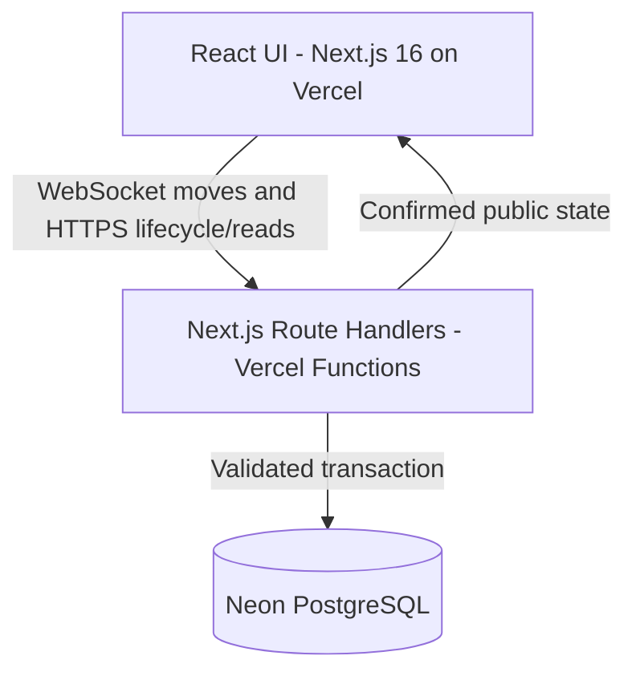

# Architecture — Wedge's Trial

## Scope

This directory documents the **implemented server-authoritative gameplay** and the **remaining approved product target**. Read `status.md` first. Do not imply implementation just because a component appears in a target diagram.

The domain engine remains **pure TypeScript** and is executed by the server for trusted outcomes. Client code handles controls, transient movement prediction, reconciliation and presentation. Resources, rewards and terminal status remain server-confirmed.

## Documents

| Document | Purpose |
| --- | --- |
| [server-setup.md](server-setup.md) | Environment variables, migrations, local WebSockets and troubleshooting |
| [lock-benchmarks.md](lock-benchmarks.md) | Reproducible Node/Preview engine timings, Neon recovery and Hobby resource assessment (#28) |
| [lock-validation.md](lock-validation.md) | Explicit solver outcomes, legal witnesses, seeded difficulty/fallback distributions and Preview gates (#50) |
| [status.md](status.md) | Present implementation, target, migration boundaries |
| [decisions.md](decisions.md) | Approved decisions and open design questions |
| [gameplay.md](gameplay.md) | Domain invariants, progression and reward design |
| [new-player-progression-plan.md](new-player-progression-plan.md) | Original #48 learning-ramp plan; lockpick balance preserved |
| [learning-progression-report.md](learning-progression-report.md) | Implemented learning-ramp-v1, paired benchmark evidence and pending human/Preview acceptance |
| [competitive-ranking.md](competitive-ranking.md) | Approved endless ore ordering, qualification, sustainability and version boundaries (#51) |
| [backend.md](backend.md) | API, run lifecycle, transactions, error semantics |
| [api-contract.md](api-contract.md) | Canonical v1 requests, DTOs, lifecycle, examples and retry rules (#29) |
| [data-model.md](data-model.md) | Implemented schema, replay storage and planned ranking tables |
| [security.md](security.md) | Trust boundary, sessions, abuse cases |
| [audio-assets.md](audio-assets.md) | Audio design and asset licensing requirements |
| [roadmap.md](roadmap.md) | Issue links and implementation sequence |

## Guiding principles

1. One repository; do not introduce a standalone Node server by default.
2. Each gameplay mutation is server-calculated, authorized, versioned, transactional and retry-safe.
3. A browser may display derived game state but never supplies authoritative state or score.
4. Separate game-domain logic, orchestration/persistence, API boundaries and React rendering.
5. Retain pure puzzle functions and existing tests while keeping authoritative orchestration on the server.
6. Prefer no new infrastructure beyond Vercel and Neon until measured need justifies it.
7. Protect gameplay fairness while acknowledging server authority cannot stop every bot or automated solver.

## Frontend features

Product-specific React code belongs in `src/features/<name>/`. Gameplay owns its screen, hooks, dialogs and lock rendering; development inspection belongs to `features/lock-debug`. Routes consume their minimal public APIs. Shared primitives/site components stay in `components`, dictionaries in `i18n`, and the domain/client/server layers retain their existing roles. See [ownership, dependency rules and how to add a feature](module-boundaries.md). Run `pnpm check:architecture` for actionable dependency and cycle checks; lint, tests and CI enforce them.

## Current and historical engine measurements

- [Post-#61 baseline performance](lock-benchmarks.md) and [difficulty/resource sustain](lock-validation.md).
- [2026-11-05 performance](archive/2026-11-05-lock-benchmarks.md) and [2026-11-05 validation](archive/2026-11-05-lock-validation.md).
- [Archive checksums and source snapshot](../../benchmarks/results/archive/manifest.json). Historical raw files are byte-for-byte copies; only relative report links were repaired.
