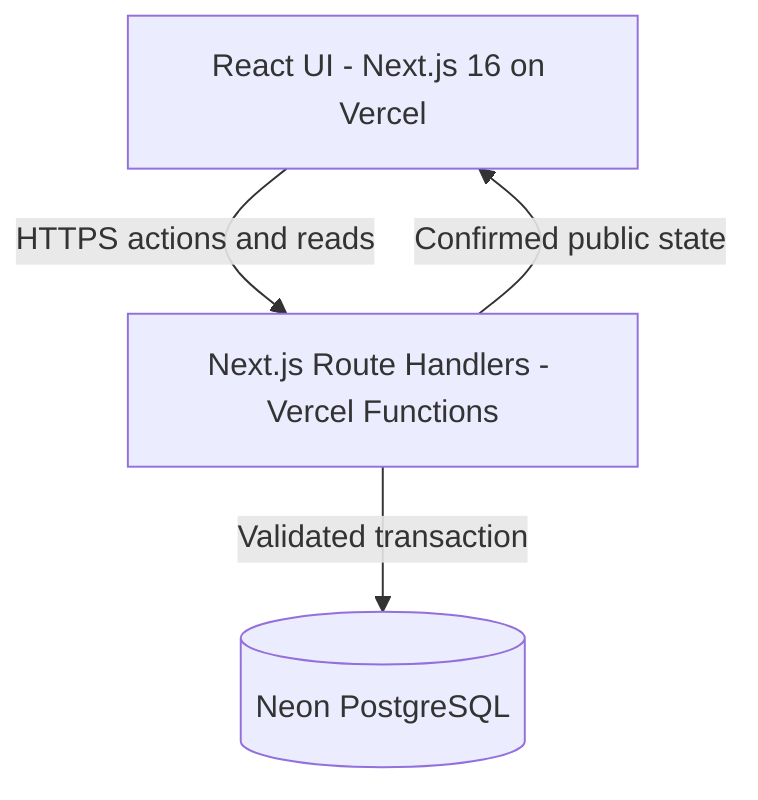

# Architecture — Wedge's Trial

## Scope

This directory documents both the **current client-side MVP** and the **chosen future server-authoritative architecture**. Read `status.md` first. Do not imply implementation just because a component appears in a target diagram.

The domain engine remains **pure TypeScript** and is executed by the server for trusted outcomes. Client code handles visuals, controls, transient UI state and audio.

## Documents

| Document | Purpose |
| --- | --- |
| [status.md](status.md) | Present implementation, target, migration boundaries |
| [decisions.md](decisions.md) | Approved decisions and open design questions |
| [gameplay.md](gameplay.md) | Domain invariants, progression and reward design |
| [backend.md](backend.md) | API, run lifecycle, transactions, error semantics |
| [data-model.md](data-model.md) | Proposed PostgreSQL schema and integrity rules |
| [security.md](security.md) | Trust boundary, sessions, abuse cases |
| [audio-assets.md](audio-assets.md) | Audio design and asset licensing requirements |
| [roadmap.md](roadmap.md) | Issue links and implementation sequence |

## Guiding principles

1. One repository; do not introduce a standalone Node server by default.
2. Each gameplay mutation is server-calculated, authorized, versioned, transactional and retry-safe.
3. A browser may display derived game state but never supplies authoritative state or score.
4. Separate game-domain logic, orchestration/persistence, API boundaries and React rendering.
5. Retain pure puzzle functions and existing tests while replacing client-side orchestration in increments.
6. Prefer no new infrastructure beyond Vercel and Neon until measured need justifies it.
7. Protect gameplay fairness while acknowledging server authority cannot stop every bot or automated solver.
